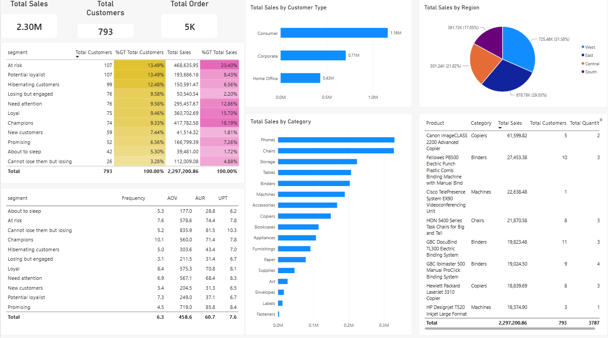

# Customer Segmentation with RFM Analysis: Superstore

Segmenting 793 customers of a retail superstore (4 years of orders, ~USD 2.3M in sales) into 11 behavioral groups using an RFM model, then turning each group into a concrete marketing action. RFM scoring and segmentation were done in Excel, and the results were visualized in a Power BI dashboard, as part of a Data Analyst bootcamp.



## Business Problem

Marketing treats all customers the same. Which customers generate the most revenue, which are about to leave, and where should a limited retention budget go first?

## Dataset

| Item | Detail |
|---|---|
| Source | Superstore sales dataset (`data/superstore_segmentation.csv`) |
| Period | 2014-01-03 to 2017-12-30 |
| Size | 9,994 order lines, 5,009 orders, 793 customers |
| Total sales | 2,297,200.86 |
| Key fields | customer_id, order_id, order_date, region, category, subcategory, product_name, sales, quantity |

## Methodology

**1. RFM scoring (Excel).** Each customer gets a score of 1 to 5 per dimension, based on quintiles (20th/40th/60th/80th percentiles).

| Score | Recency (days since last order) | Frequency (orders) | Monetary (total sales) |
|---|---|---|---|
| 5 | 0-26 | >= 10 | >= 4,283 |
| 4 | 27-53 | 8-9 | 2,751-4,282 |
| 3 | 54-103 | 6-7 | 1,740-2,750 |
| 2 | 104-224 | 5 | 962-1,739 |
| 1 | >= 225 | <= 4 | <= 961 |

Thresholds are calculated with `PERCENTILE` in the `aggregation` sheet. Recency is days between each customer's last order and the latest date in the data (2017-12-30). Frequency thresholds are rounded up (`ROUNDUP`) because order counts are whole numbers.

**2. Segment mapping (Excel).** The 125 possible RFM combinations are listed in the `RFM mapping` sheet and mapped to 11 named segments (Champions, Loyal, At Risk, and so on). Each customer's RFM key (for example `545`) is matched to its segment with `XLOOKUP`.

**3. Segment profiling (Power BI).** Each segment is described with average frequency, AOV (average order value), AUR (average unit retail) and UPT (units per transaction), plus best-selling categories and regional index (segment share / overall share; above 1x means over-represented).

**4. Recommendation per segment.** Every segment gets one action tied to its profile.

## Results

| Segment | Customers | % Customers | Sales | % Sales | Frequency | AOV |
|---|---|---|---|---|---|---|
| At Risk | 107 | 13.49% | 468,636 | 20.40% | 7.6 | 578.6 |
| Champions | 74 | 9.33% | 417,783 | 18.19% | 10.1 | 560.0 |
| Loyal | 75 | 9.46% | 360,703 | 15.70% | 8.4 | 575.3 |
| Need Attention | 76 | 9.58% | 295,458 | 12.86% | 6.9 | 567.1 |
| Potential Loyalist | 107 | 13.49% | 193,686 | 8.43% | 7.3 | 249.0 |
| Promising | 52 | 6.56% | 166,799 | 7.26% | 4.5 | 719.0 |
| Hibernating | 99 | 12.48% | 150,591 | 6.56% | 5.0 | 303.6 |
| Cannot Lose Them but Losing | 26 | 3.28% | 112,009 | 4.88% | 5.2 | 835.9 |
| Losing but Engaged | 76 | 9.58% | 50,541 | 2.20% | 3.1 | 211.5 |
| New Customers | 59 | 7.44% | 41,514 | 1.81% | 3.4 | 204.5 |
| About to Sleep | 42 | 5.30% | 39,481 | 1.72% | 5.3 | 177.0 |

### Key findings

1. **At Risk is the biggest revenue pool (20.40% of sales)** but has not purchased recently. This is the top retention priority.
2. **Champions are only 9.33% of customers but generate 18.19% of sales.** Protect them with a VIP program.
3. **Multi-category orders are worth 2.9x more** among Potential Loyalists (405.6 vs 140.7 per order). The most frequent pair is Binders + Paper (35 orders), which supports bundling.

### Recommended budget focus

Retain At Risk and Need Attention, protect Champions and Loyal, cross-sell to Potential Loyalist, and use low-cost activation for dormant segments.

## Repository Structure

```
.
├── README.md
├── data/
│   └── superstore_segmentation.csv
├── analysis/
│   └── RFM_Scoring.xlsx
├── dashboard/
│   └── Customer_Segmentation.pbix
├── presentation/
│   └── Customer_Segmentation_Analysis_Presentation.pdf
└── images/
    └── dashboard.png
```

## Excel Workbook

`analysis/RFM_Scoring.xlsx` contains five sheets: `segmentation - superstore` (raw data), `description` (column dictionary), `aggregation` (per-customer recency, frequency, monetary and percentile thresholds), `scoring` (R/F/M scores, RFM key, segment) and `RFM mapping` (125 combinations to 11 segments). It uses dynamic-array functions, so open it in Excel 2021 or Microsoft 365.

## How to Open

1. Download `dashboard/Customer_Segmentation.pbix`.
2. Open it in Power BI Desktop (free).
3. If the data source path breaks, point it to `data/superstore_segmentation.csv` under *Transform data > Data source settings*.

## Tools

Excel (`UNIQUE`, `MAXIFS`, `SUMIFS`, `PERCENTILE`, `IFS`, `XLOOKUP`; RFM scoring, quintile thresholds, segment mapping) and Power BI (DAX measures, dashboard).

## Author

**Vino Jayrasta Samudra**: Data Analyst (bootcamp graduate), based in Surabaya, Indonesia.
